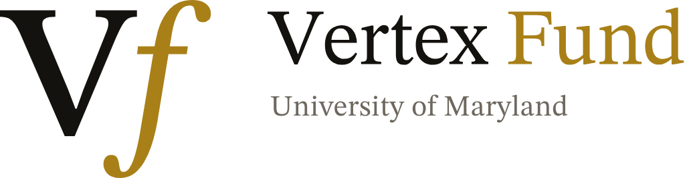
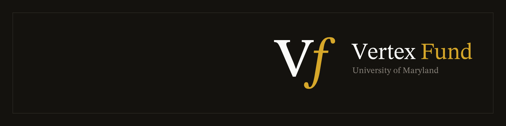
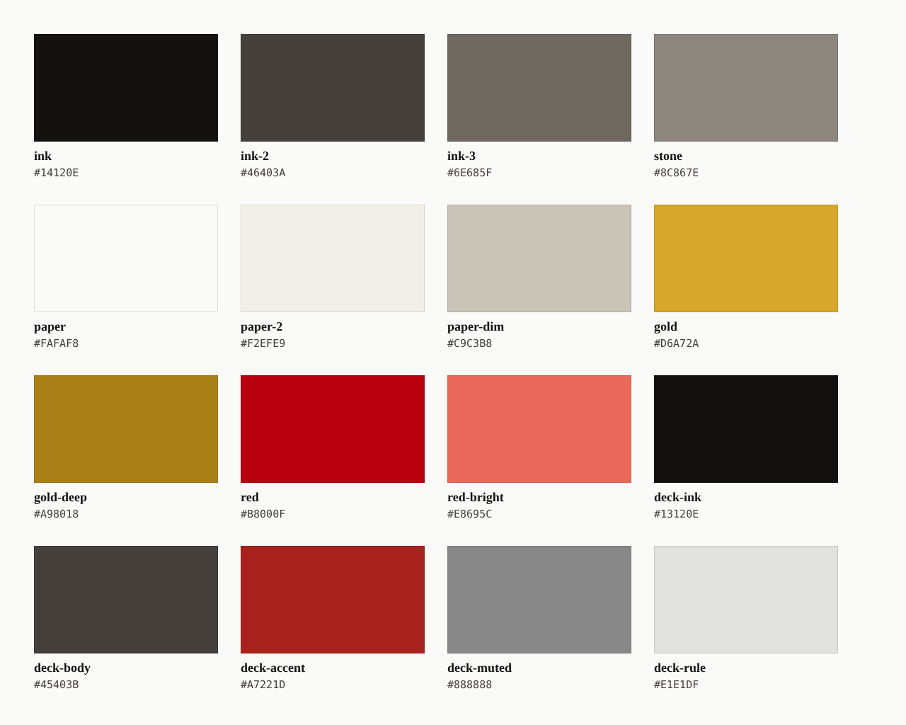
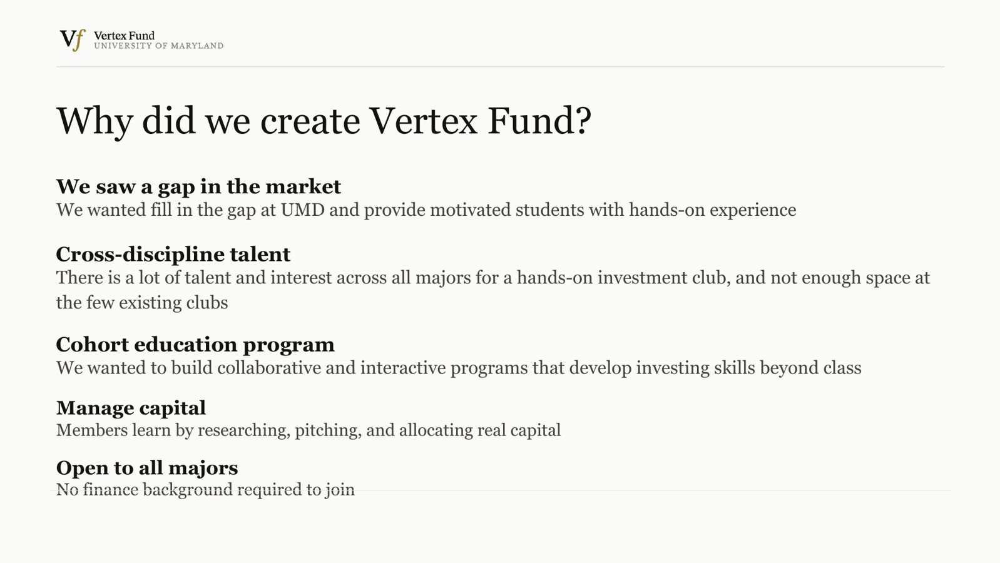

# Vertex Fund brand assets

Everything here is ready to download and use. To save a file from GitHub, click it, then click the download button at the top right. To get everything at once, use **Code → Download ZIP** on the repo's front page.

These files are generated from the master files by `tools/export_assets.py`. Don't edit them by hand. If a logo or color changes, regenerate them.

## Logos — `logos/`

| Use it on | Monogram | Full logo (lockup) |
|---|---|---|
| Light backgrounds | `monogram/vf-monogram-on-light` | `lockup/vf-lockup-on-light` |
| Dark backgrounds | `monogram/vf-monogram-on-dark` | `lockup/vf-lockup-on-dark` |
| One-color print, light background | `monogram/vf-monogram-mono-ink` | `lockup/vf-lockup-mono-ink` |
| One-color print or over photos, dark background | `monogram/vf-monogram-mono-paper` | `lockup/vf-lockup-mono-paper` |

Every lockup also comes in two extra versions:
- **`-caps`** sets "UNIVERSITY OF MARYLAND" in widely spaced capitals. That subline is the only place capitals are allowed; sentence case is the default.
- **`-short`** is the mark plus "Vertex Fund" with no subline. Use it at small sizes (LinkedIn covers, email signatures, slide headers), where the subline would be unreadable.

All logo files have built-in breathing room, so nothing touches the edge. Still leave clear space around them.

Each logo comes in three versions:
- **.svg:** vector; sharp at any size. Use it for print, the web, Figma and Canva.
- **-1024w.png:** transparent background. Use it for slides and documents.
- **-2048w.png:** transparent background, high resolution.

## Social — `social/`

| File | Where it goes |
|---|---|
| `profile-avatar-ink-400.png` / `-1080.png` | Instagram, LinkedIn, GroupMe, TerpLink profile picture (default) |
| `profile-avatar-paper-*.png` | Light alternative |
| `profile-avatar-transparent-light-mark-*.png` | Transparent background; light V and gold *f*. Place it on dark photos or colors |
| `profile-avatar-transparent-dark-mark-*.png` | Transparent background; ink V and gold *f*. Place it on light backgrounds |
| `linkedin-banner-1584x396.png` | LinkedIn personal profile banner (the logo sits right so the profile photo doesn't cover it) |
| `linkedin-company-cover-1128x191.png` | LinkedIn company page cover |
| `link-preview-1200x630.png` | Link preview image (website meta tags, event pages) |

## Favicon — `favicon/`
`favicon.svg` plus `favicon-32.png`, `apple-touch-icon-180.png` and `icon-512.png` (dark square) for websites.

Transparent versions: `-transparent-dark-mark` for light browser themes and `-transparent-light-mark` for dark ones. Apple touch icons ignore transparency, so only the solid one is provided.

## Colors — `colors/`
`palette.png` is a swatch sheet; `palette.txt` lists hex and RGB values to copy and paste.

- **Gold** means identity (the *f*, the word "Fund", highlights).
- **Red** means action (Apply, deadlines, losses).

## Fonts — `fonts/`
EB Garamond, STIX Two Text and DM Mono, all free. See `fonts/README.md` for links and how to add them to Google Slides.

## Photos — `photos/`

**`events/`** holds our own event and team photos, as JPGs that open in Slides and Canva.

**`headshots/`** holds executive headshots, square-ish, as JPG.

- **Use our own photos before any stock photo.**
- Give every photo in a set the same light edit.
- No filters.
- Ask the person before using their headshot outside Vertex Fund materials.
- For the full-resolution originals, see the website repo (`vertex-fund-website/pictures`).

## References — `previews/`
These are designs we actually used. Match them when making something new.
- **`event-slideshow/`:** all 15 slides plus a PDF of the deck we presented at the Nov 18 interest meeting. Every new deck should look like this one.
- **`posted-interest-meeting.png`:** the Instagram post announcing the interest meeting.
- **`thanks-for-coming-posted.jpg`:** the "Thanks for coming!" carousel cover we posted.

The rules are in `brand-guidelines.md`.
